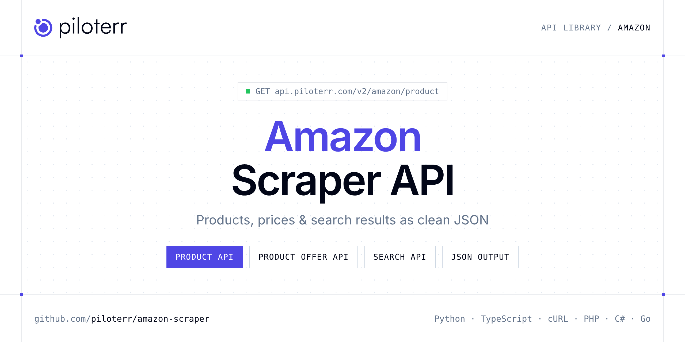

<p align="center">
  <a href="https://www.piloterr.com"></a>
</p>

# Amazon Scraper API

[](https://discord.gg/CFj3ph8aHU) [](https://app.piloterr.com) [](https://app.piloterr.com/openapi) [](LICENSE)

The **Piloterr Amazon Scraper API** lets you extract public data from Amazon as **clean, structured JSON** — no proxies, headless browsers or HTML parsing to maintain. Endpoints available in production:

- **Amazon Product API** — Efficiently extract product details from Amazon for dynamic retail insights, including price, stock, features, and seller data.
- **Amazon Product Offer API** — Efficiently extract details of third-party seller offers for any Amazon product across multiple marketplaces.
- **Amazon Search API** — Efficiently scrape Amazon search results for real-time product data and insights across multiple Amazon marketplaces.

Use it for price monitoring, assortment tracking, competitor analysis, product research or catalog enrichment.

| Endpoint | Path | Credits | What you get |
|---|---|---|---|
| [Amazon Product API](#amazon-product-api) | `/v2/amazon/product` | 1 | Efficiently extract product details from Amazon for dynamic retail insights, including price, stock, features, and seller data. |
| [Amazon Product Offer API](#amazon-product-offer-api) | `/v2/amazon/product/offer` | 1 | Efficiently extract details of third-party seller offers for any Amazon product across multiple marketplaces. |
| [Amazon Search API](#amazon-search-api) | `/v2/amazon/search` | 1 | Efficiently scrape Amazon search results for real-time product data and insights across multiple Amazon marketplaces. |

## Table of contents

- [How it works](#how-it-works)
- [Amazon Product API](#amazon-product-api)
- [Amazon Product Offer API](#amazon-product-offer-api)
- [Amazon Search API](#amazon-search-api)
- [Code examples in other languages](#code-examples-in-other-languages)
- [Practical use cases](#practical-use-cases)
- [Why Piloterr?](#why-piloterr)
- [FAQ](#faq)
- [Related scrapers](#related-scrapers)
- [Support](#support)

## How it works

1. **Create a free Piloterr account** and copy your API key from the [dashboard](https://app.piloterr.com).
2. **Send a `GET` (or `POST`) request** to `https://api.piloterr.com/v2/...` with the header `x-api-key: YOUR_API_KEY`.
3. **Receive structured JSON** — Piloterr handles rendering, proxies, retries and parsing.

```bash
export PILOTERR_API_KEY="your-api-key"
pip install requests        # Python
# TypeScript: Node.js 18+ (native fetch), run with `npx tsx file.ts`
```

> Every endpoint accepts both `GET` (query string) and `POST` (JSON body with the same fields).

## Amazon Product API

Efficiently extract product details from Amazon for dynamic retail insights, including price, stock, features, and seller data.

`GET | POST https://api.piloterr.com/v2/amazon/product` · **1 credit per request** · [Full reference](https://app.piloterr.com/openapi)

### Request parameters

| Parameter | Type | Required | Description |
|---|---|---|---|
| `query` | string | ✅ | Amazon product ASIN (Amazon Standard Identification Number) to retrieve full product details for. |
| `domain` | string | — | Amazon domain extension to query. Controls which Amazon marketplace is targeted. |

### Python example

```python
import json
import os
import requests

response = requests.get(
    "https://api.piloterr.com/v2/amazon/product",
    headers={"x-api-key": os.environ["PILOTERR_API_KEY"]},
    params={
        "query": "B09DFCB66S",
    },
    timeout=60,
)
response.raise_for_status()
data = response.json()

print(json.dumps(data, indent=2, ensure_ascii=False)[:2000])
```

### TypeScript example

```typescript
type AmazonProduct = {
  url?: string;
  asin?: string;
  image?: string;
  price?: unknown;
  stock?: string;
  title?: string;
  coupon?: unknown;
  images?: {
    url?: string;
    type?: string;
  }[];
  currency?: unknown;
  features?: string[];
  variants?: unknown[];
  description?: string;
  product_information?: {
    asin?: string;
    rated?: string;
    batteries?: string;
    item_weight?: string;
    manufacturer?: string;
    release_date?: string;
    type_of_item?: string;
    best_sellers_rank?: string[];
    item_model_number?: string;
    product_dimensions?: string;
    date_first_available?: string;
  };
  merchant_information?: unknown;
};

const params = new URLSearchParams({
  "query": "B09DFCB66S",
});

const response = await fetch(`https://api.piloterr.com/v2/amazon/product?${params}`, {
  headers: { "x-api-key": process.env.PILOTERR_API_KEY! },
});
if (!response.ok) throw new Error(`Piloterr error ${response.status}: ${await response.text()}`);

const data = (await response.json()) as AmazonProduct;

console.log(JSON.stringify(data, null, 2).slice(0, 2000));
```

<details>
<summary><b>POST variant</b></summary>

```http
POST https://api.piloterr.com/v2/amazon/product
x-api-key: YOUR_API_KEY
Content-Type: application/json

{"query": "B09DFCB66S"}
```
</details>

### Output example

Example response from the API reference, abridged — real values depend on the page you scrape.

```json
{
  "url": "https://www.amazon.com/dp/B09DFCB66S",
  "asin": "B09DFCB66S",
  "image": "https://m.media-amazon.com/images/I/51051FiD9UL._AC_SL1500_.jpg",
  "price": null,
  "stock": "Only 5 left in stock - order soon.",
  "title": "PlayStation PS5 HW 1115 STANDARD_US - PlayStation 5",
  "coupon": null,
  "images": [
    {
      "url": "https://m.media-amazon.com/images/I/51051FiD9UL._AC_SL1500_.jpg",
      "type": "main"
    },
    {
      "url": "https://m.media-amazon.com/images/I/61A2b3C4d5L._AC_SL1500_.jpg",
      "type": "gallery"
    }
  ],
  "currency": null,
  "features": [
    "Stunning Games - Marvel at incredible graphics and experience new PS5 features.",
    "Breathtaking Immersion - Discover a deeper gaming experience with support for haptic feedback, adaptive triggers, and 3D Audio technology."
  ],
  "variants": [],
  "description": "The PS5 console unleashes new gaming possibilities that you never anticipated. Experience lightning fast loading with an ultra-high speed…",
  "product_information": {
    "asin": "B09DFCB66S",
    "rated": "Rating Pending",
    "batteries": "1 Lithium Ion batteries required. (included)",
    "item_weight": "15.17 pounds",
    "manufacturer": "Sony",
    "release_date": "October 22, 2021",
    "type_of_item": "Video Game",
    "best_sellers_rank": [
      "#30,675 in Video Games (See Top 100 in Video Games)",
      "#95 in PlayStation 5 Consoles"
    ],
    "item_model_number": "Internacional",
    "product_dimensions": "18 x 18 x 12 inches; 15.17 Pounds",
    "date_first_available": "June 21, 2021"
  },
  "merchant_information": null
}
```

### Response fields

| Field | Type | Description |
|---|---|---|
| `url` | string |  |
| `asin` | string |  |
| `image` | string |  |
| `price` | object |  |
| `stock` | string |  |
| `title` | string |  |
| `coupon` | object |  |
| `images[]` | object[] |  |
| `images[].url` | string |  |
| `images[].type` | string |  |
| `currency` | object |  |
| `features` | string[] |  |
| `variants` | any[] |  |
| `description` | string |  |
| `product_information` | object |  |
| `product_information.asin` | string |  |
| `product_information.rated` | string |  |
| `product_information.batteries` | string |  |
| `product_information.item_weight` | string |  |
| `product_information.manufacturer` | string |  |
| `product_information.release_date` | string |  |
| `product_information.type_of_item` | string |  |
| `product_information.best_sellers_rank` | string[] |  |
| `product_information.item_model_number` | string |  |
| `product_information.product_dimensions` | string |  |

## Amazon Product Offer API

Efficiently extract details of third-party seller offers for any Amazon product across multiple marketplaces.

`GET | POST https://api.piloterr.com/v2/amazon/product/offer` · **1 credit per request** · [Full reference](https://app.piloterr.com/openapi)

### Request parameters

| Parameter | Type | Required | Description |
|---|---|---|---|
| `query` | string | ✅ | Amazon product ASIN (Amazon Standard Identification Number) to retrieve third-party seller offers for. |
| `domain` | string | — | Amazon domain extension to query. Controls which Amazon marketplace is targeted. |
| `page` | number | — | Page number for paginated offer results. |

### Python example

```python
import json
import os
import requests

response = requests.get(
    "https://api.piloterr.com/v2/amazon/product/offer",
    headers={"x-api-key": os.environ["PILOTERR_API_KEY"]},
    params={
        "query": "B093C9B1HK",
    },
    timeout=60,
)
response.raise_for_status()
data = response.json()

print(json.dumps(data, indent=2, ensure_ascii=False)[:2000])
```

### TypeScript example

```typescript
type AmazonProductOffer = {
  results?: {
    asin?: string;
    price?: number;
    seller_url?: string;
    seller_name?: string;
    delivery_info?: {
      time?: string;
      type?: string;
      price?: string;
    };
    discount_percentage?: number;
  }[];
};

const params = new URLSearchParams({
  "query": "B093C9B1HK",
});

const response = await fetch(`https://api.piloterr.com/v2/amazon/product/offer?${params}`, {
  headers: { "x-api-key": process.env.PILOTERR_API_KEY! },
});
if (!response.ok) throw new Error(`Piloterr error ${response.status}: ${await response.text()}`);

const data = (await response.json()) as AmazonProductOffer;

console.log(JSON.stringify(data, null, 2).slice(0, 2000));
```

<details>
<summary><b>POST variant</b></summary>

```http
POST https://api.piloterr.com/v2/amazon/product/offer
x-api-key: YOUR_API_KEY
Content-Type: application/json

{"query": "B093C9B1HK"}
```
</details>

### Output example

Example response from the API reference, abridged — real values depend on the page you scrape.

```json
{
  "results": [
    {
      "asin": "B093C9B1HK",
      "price": 16.21,
      "seller_url": "https://www.amazon.fr/Amazon-Offres-Reconditionnees/b?ie=UTF8&node=3581943031",
      "seller_name": "example",
      "delivery_info": {
        "time": "vendredi 23 mai",
        "type": "Livraison",
        "price": "GRATUITE"
      },
      "discount_percentage": 0
    },
    {
      "asin": "B093C9B1HK",
      "price": 19.99,
      "seller_url": "https://www.amazon.fr/gp/aag/main?ie=UTF8&seller=A1C2OJL0SJT92U&isAmazonFulfilled=1&asin=B093C9B1HK",
      "seller_name": "example",
      "delivery_info": {
        "time": "vendredi 23 mai",
        "type": "Livraison",
        "price": "GRATUITE"
      },
      "seller_rating": "Nouveau vendeur",
      "discount_percentage": 13
    }
  ]
}
```

### Response fields

| Field | Type | Description |
|---|---|---|
| `results[]` | object[] |  |
| `results[].asin` | string |  |
| `results[].price` | number |  |
| `results[].seller_url` | string |  |
| `results[].seller_name` | string |  |
| `results[].delivery_info` | object |  |
| `results[].discount_percentage` | integer |  |

## Amazon Search API

Efficiently scrape Amazon search results for real-time product data and insights across multiple Amazon marketplaces.

`GET | POST https://api.piloterr.com/v2/amazon/search` · **1 credit per request** · [Full reference](https://app.piloterr.com/openapi)

### Request parameters

| Parameter | Type | Required | Description |
|---|---|---|---|
| `query` | string | ✅ | Keyword or phrase to search for products on Amazon. |
| `domain` | string | — | Amazon domain extension to query. Controls which Amazon marketplace is searched. |
| `page` | number | — | Page number for paginated search results. Each page returns up to 60 results. |

### Python example

```python
import json
import os
import requests

response = requests.get(
    "https://api.piloterr.com/v2/amazon/search",
    headers={"x-api-key": os.environ["PILOTERR_API_KEY"]},
    params={
        "query": "playstation 5",
    },
    timeout=60,
)
response.raise_for_status()
data = response.json()

print(json.dumps(data, indent=2, ensure_ascii=False)[:2000])
```

### TypeScript example

```typescript
type AmazonSearch = {
  url?: string;
  asin?: string;
  price?: unknown;
  title?: string;
  rating?: number;
  real_price?: number;
  reviews_count?: number;
}[];

const params = new URLSearchParams({
  "query": "playstation 5",
});

const response = await fetch(`https://api.piloterr.com/v2/amazon/search?${params}`, {
  headers: { "x-api-key": process.env.PILOTERR_API_KEY! },
});
if (!response.ok) throw new Error(`Piloterr error ${response.status}: ${await response.text()}`);

const data = (await response.json()) as AmazonSearch;

console.log(JSON.stringify(data, null, 2).slice(0, 2000));
```

<details>
<summary><b>POST variant</b></summary>

```http
POST https://api.piloterr.com/v2/amazon/search
x-api-key: YOUR_API_KEY
Content-Type: application/json

{"query": "playstation 5"}
```
</details>

### Output example

Example response from the API reference, abridged — real values depend on the page you scrape.

```json
[
  {
    "url": "https://www.amazon.com/PlayStation%C2%AE5-Digital-825GB-PlayStation-5/dp/B0FRGMYJMG/ref=sr_1_1",
    "asin": "B0FRGMYJMG",
    "price": null,
    "title": "PlayStation®5 Digital Edition – 825GB",
    "rating": 4.8,
    "real_price": 344.5,
    "reviews_count": 196
  },
  {
    "url": "https://www.amazon.com/PS5-Playstation-Digital-Wireless-Controller/dp/B0966NLTZS/ref=sr_1_2",
    "asin": "B0966NLTZS",
    "price": 414.42,
    "title": "PS5 - Sony PlayStation 5 Digital Edition Gaming Console + Wireless Controller",
    "rating": 4.4,
    "real_price": 362.62,
    "reviews_count": 248
  }
]
```

### Response fields

| Field | Type | Description |
|---|---|---|

## Code examples in other languages

Ready-to-run examples live in the [`examples/`](examples) folder. Each one reads your key from the `PILOTERR_API_KEY` environment variable.

| Language | Product | Product Offer | Search |
|---|---|---|---|
| cURL (Bash) | [`product`](examples/curl/product.sh) | [`product-offer`](examples/curl/product_offer.sh) | [`search`](examples/curl/search.sh) |
| PHP | [`product`](examples/php/product.php) | [`product-offer`](examples/php/product_offer.php) | [`search`](examples/php/search.php) |
| C# | [`product`](examples/csharp/Product.cs) | [`product-offer`](examples/csharp/ProductOffer.cs) | [`search`](examples/csharp/Search.cs) |
| Go | [`product`](examples/go/product.go) | [`product-offer`](examples/go/product_offer.go) | [`search`](examples/go/search.go) |
| Java | [`product`](examples/java/ProductExample.java) | [`product-offer`](examples/java/ProductOfferExample.java) | [`search`](examples/java/SearchExample.java) |
| Ruby | [`product`](examples/ruby/product.rb) | [`product-offer`](examples/ruby/product_offer.rb) | [`search`](examples/ruby/search.rb) |
| Node.js | [`product`](examples/nodejs/product.mjs) | [`product-offer`](examples/nodejs/product_offer.mjs) | [`search`](examples/nodejs/search.mjs) |

## Practical use cases

- **Price monitoring** — Track prices, promotions and availability over time to react to competitors.
- **Assortment & catalog tracking** — Follow new products, delisted items and category changes.
- **Competitor analysis** — Benchmark ranges, brands and positioning across retailers.
- **Product research** — Spot best-sellers and trends from search results.
- **Catalog enrichment** — Pull titles, images and attributes into your PIM or marketplace listings.

## Why Piloterr?

- **No infrastructure** — no proxies, headless browsers or CAPTCHA solving to run yourself.
- **Structured JSON** — stable, documented fields instead of brittle HTML selectors.
- **Pay per request** — transparent credit cost per endpoint, failed requests are retried for you.
- **One API key, hundreds of sources** — Amazon plus many other e-commerce, search and company data endpoints in the [Piloterr library](https://www.piloterr.com/library).
- **Any language** — plain HTTPS + JSON, with examples for Python, TypeScript, cURL, PHP, C#, Go, Java, Ruby and Node.js.

## FAQ

### Is it legal to scrape Amazon?

Collecting publicly available data is generally allowed in many jurisdictions, but rules depend on your country, the data you collect and how you use it. Avoid personal data unless you have a lawful basis, respect the website's terms where they apply, and get legal advice for your specific use case. This is not legal advice.

### Do I need proxies or a headless browser?

No. Piloterr handles rendering, proxy rotation and retries on its side. You only send an HTTPS request with your `x-api-key` header and receive JSON.

### How much does a request cost?

Credits per call: `/v2/amazon/product` **1**, `/v2/amazon/product/offer` **1**, `/v2/amazon/search` **1**. See the [Piloterr website](https://www.piloterr.com) for plans.

### What data does the Amazon API return?

Each endpoint returns structured JSON: **Amazon Product** — `url`, `asin`, `image`, `price`, `stock`, `title`; **Amazon Product Offer** — `results[]`, `results[].asin`, `results[].price`, `results[].seller_url`, `results[].seller_name`, `results[].delivery_info`; **Amazon Search** — see the reference.

### How do I paginate Amazon results?

Use the `page` parameter and keep requesting while the response indicates more results.

### Can I target a specific country or language?

Yes, use `domain` — see the parameter tables above for accepted values.

### Which languages are supported?

Any language that can make an HTTP request. This README shows Python and TypeScript; the [`examples/`](examples) folder contains cURL, PHP, C#, Go, Java, Ruby and Node.js.

## Related scrapers

- [About You Scraper API](https://github.com/piloterr/aboutyou-scraper)
- [Action Scraper API](https://github.com/piloterr/action-scraper)
- [Aldi Scraper API](https://github.com/piloterr/aldi-scraper)
- [Alibaba Scraper API](https://github.com/piloterr/alibaba-scraper)
- [AliExpress Scraper API](https://github.com/piloterr/aliexpress-scraper)
- [Allegro Scraper API](https://github.com/piloterr/allegro-scraper)
- [All Piloterr scrapers on GitHub](https://github.com/piloterr)

## Support

- 💬 Join the [Piloterr Discord](https://discord.gg/CFj3ph8aHU) to ask questions and share what you build.
- 📚 Browse the [API reference (OpenAPI)](https://app.piloterr.com/openapi) and the [Piloterr library](https://www.piloterr.com/library).
- 🔑 [Get your API key](https://app.piloterr.com).

---

<p align="center">
  <a href="https://www.piloterr.com">
    <picture>
      <source media="(prefers-color-scheme: dark)" srcset="images/logo-dark.svg">
      
    </picture>
  </a>
  <br>
  <sub>Built by <a href="https://www.piloterr.com">Piloterr</a> — web scraping APIs for e-commerce, search, real estate and more, one API key.</sub>
</p>

<sub>Amazon is a trademark of its respective owner. This repository is not affiliated with or endorsed by Amazon. Examples are released under the MIT license.</sub>
